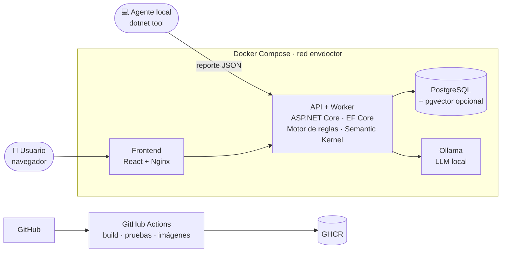
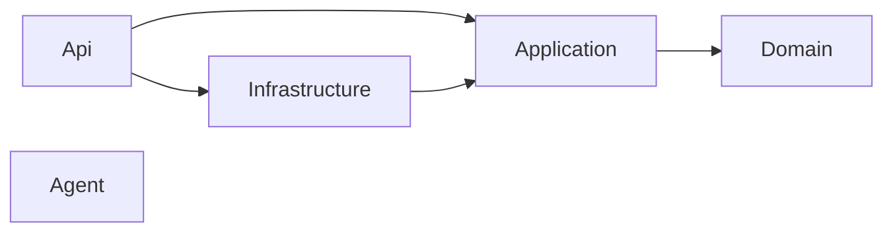
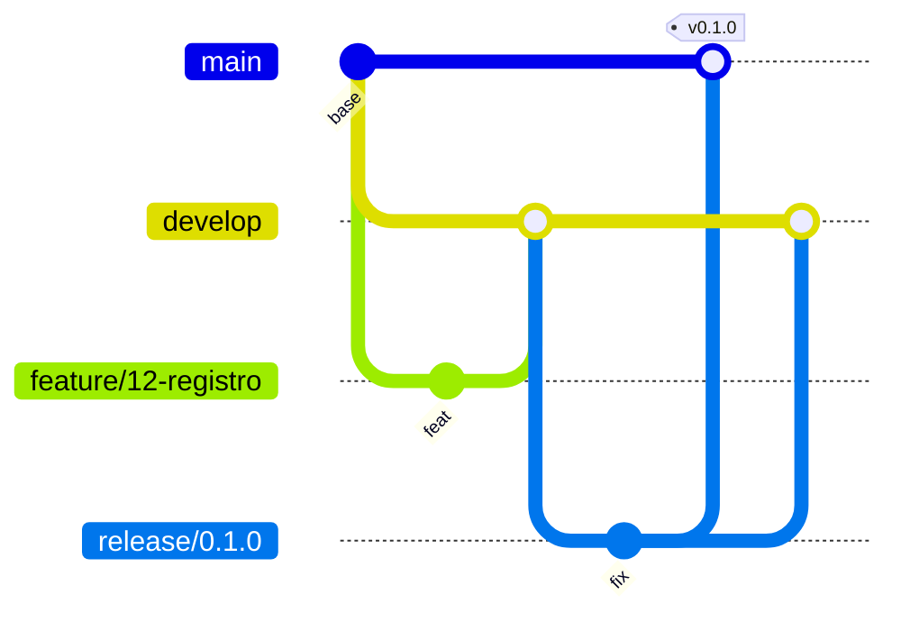

<div align="center">

# 🩺 EnvDoctor

**El médico de los entornos de desarrollo**

Diagnostica por qué un proyecto no compila, no inicia o se comporta distinto entre computadoras,<br>
con reglas verificables y un asistente de IA que siempre cita la evidencia.

[](https://github.com/luisbravobello/envDoctor/actions/workflows/ci.yml)


[Características](#-características) ·
[Arquitectura](#-arquitectura) ·
[Inicio rápido](#-inicio-rápido) ·
[Documentación](#-documentación) ·
[Contribuir](CONTRIBUTING.md)

</div>

---

> [!NOTE]
> **Estado: Sprint 0 (Fundación).** El repositorio contiene la estructura base, sin lógica de negocio. Proyecto integral de **Software Configuration Management I**, opción 1 (Full Stack + IA + DevOps).

## 📑 Tabla de contenidos

- [¿Qué es EnvDoctor?](#-qué-es-envdoctor)
- [Características](#-características)
- [Stack tecnológico](#-stack-tecnológico)
- [Arquitectura](#-arquitectura)
- [Estructura del repositorio](#-estructura-del-repositorio)
- [Inicio rápido](#-inicio-rápido)
- [Flujo de trabajo](#-flujo-de-trabajo)
- [Plan por sprints](#-plan-por-sprints)
- [Documentación](#-documentación)
- [Equipo](#-equipo)

## 🔍 ¿Qué es EnvDoctor?

En el desarrollo de software es común que una aplicación funcione en una computadora y falle en otra: versiones de SDK distintas, paquetes, variables de entorno, contenedores o puertos ocupados. EnvDoctor convierte esa información dispersa en un **informe de salud priorizado y trazable**.

Su diferencial es combinar **reglas deterministas**, que verifican hechos concretos, con **IA**, que ayuda a interpretarlos. La herramienta no inventa errores ni ejecuta reparaciones sin autorización del usuario.

## ✨ Características

| Módulo | Qué hace |
|:--|:--|
| 📁 **Proyectos y análisis** | Registrar un proyecto, subir el reporte del agente o un paquete del proyecto y seguir el progreso del análisis |
| 💻 **Agente local (CLI)** | `dotnet tool` de solo lectura que detecta SDK, runtimes, Docker y puertos, y envía un reporte JSON con consentimiento |
| 🔎 **Escaneo del proyecto** | Lectura de `.sln`, `.csproj`, `TargetFramework`, paquetes NuGet y `global.json` |
| ⚙️ **Motor de diagnóstico** | Reglas versionadas de SDK, dependencias, archivos, variables, Docker Compose y puertos |
| 📊 **Informe de salud** | Hallazgos por severidad con evidencia, impacto y recomendación; filtros y marca de "no aplica" |
| 🤖 **Asistente IA** | Chat sobre el diagnóstico que explica causas probables y cita el hallazgo que lo respalda |
| 🕓 **Historial** | Análisis anteriores y comparación de hallazgos entre dos ejecuciones |

## 🧰 Stack tecnológico

| Capa | Tecnología |
|:--|:--|
| **Frontend** | React · TypeScript · Vite · Tailwind CSS |
| **Backend** | ASP.NET Core Web API (.NET 8 LTS) · Entity Framework Core |
| **Análisis .NET** | Microsoft.Build (MSBuild) y lectura estructurada de archivos |
| **Agente local** | .NET global tool (consola C#) |
| **Segundo plano** | `BackgroundService` y cola de trabajos |
| **IA** | Microsoft Semantic Kernel · Ollama (modelo local, p. ej. `qwen2.5:3b`) |
| **Base de datos** | PostgreSQL · pgvector *(opcional)* |
| **Pruebas** | xUnit · Testcontainers · Vitest · Playwright |
| **Calidad** | `dotnet format` · analizadores Roslyn · ESLint · Prettier |
| **DevOps** | Docker · Docker Compose · GitHub Actions · GitHub Container Registry |

## 🏗️ Arquitectura

Cuatro servicios contenerizados más el agente que corre en la máquina del desarrollador. Solo la API habla con PostgreSQL y con Ollama.



El backend sigue **Clean Architecture**: las dependencias apuntan hacia el dominio.



## 📂 Estructura del repositorio

```text
envDoctor/
├── src/
│   ├── EnvDoctor.Domain/           # Entidades y reglas del dominio, sin dependencias
│   ├── EnvDoctor.Application/      # Casos de uso e interfaces
│   ├── EnvDoctor.Infrastructure/   # EF Core, PostgreSQL, Semantic Kernel, analizadores
│   ├── EnvDoctor.Api/              # ASP.NET Core Web API + worker
│   └── EnvDoctor.Agent/            # Agente local (dotnet tool)
├── tests/
│   ├── EnvDoctor.UnitTests/
│   └── EnvDoctor.IntegrationTests/
├── frontend/                       # React + Vite, servido con Nginx en Docker
├── prompts/                        # Plantillas de prompts versionadas
├── samples/                        # Proyectos de ejemplo con errores conocidos
├── docs/                           # PRD, ADR, RFC, especificación y planes
├── .github/                        # Workflows y plantillas de PR e issues
├── docker-compose.yml
└── EnvDoctor.sln
```

## 🚀 Inicio rápido

### Requisitos

| Herramienta | Versión |
|:--|:--|
| .NET SDK | 8.0 (ver `global.json`) |
| Node.js | 22 |
| Docker | Docker Desktop o Engine con Compose |

### Opción 1: todo con Docker

```bash
git clone https://github.com/luisbravobello/envDoctor.git
cd envDoctor
cp .env.example .env
docker compose up --build
```

| Servicio | URL |
|:--|:--|
| Frontend | http://localhost:3000 |
| API (salud) | http://localhost:8080/health |
| PostgreSQL | `localhost:5432` |
| Ollama | http://localhost:11434 |

### Opción 2: desarrollo local

```bash
# Backend
dotnet build EnvDoctor.sln
dotnet test EnvDoctor.sln
dotnet run --project src/EnvDoctor.Api

# Frontend (en otra terminal)
cd frontend
npm install
npm run dev
```

> [!TIP]
> Antes de abrir un PR ejecuta `dotnet format EnvDoctor.sln` y, en `frontend/`, `npm run lint && npm run format:check`.

## 🔀 Flujo de trabajo

Git Flow simplificado. Todo cambio entra por Pull Request y pasa el CI.



| Rama | Propósito | Regla |
|:--|:--|:--|
| `main` | Producción; cada merge genera una versión | Solo PR desde `release/*`, CI verde, 1 aprobación |
| `develop` | Integración del sprint | Solo PR desde `feature/*`, CI verde, 1 aprobación |
| `feature/<id>-<nombre>` | Una historia de usuario | Nace de `develop` |
| `release/<versión>` | Estabilizar la entrega | Se fusiona en `main` y `develop` |

**Convenciones:** [Conventional Commits](https://www.conventionalcommits.org/es/) (`feat:`, `fix:`, `docs:`), versiones [SemVer](https://semver.org/lang/es/) con tags `vX.Y.Z`. Detalles en [CONTRIBUTING.md](CONTRIBUTING.md).

## 🗓️ Plan por sprints

| Sprint | Meta | Estado |
|:--:|:--|:--:|
| 0 | Fundación: repo, ramas, esqueleto, Compose y CI mínimo | 🟡 En curso |
| 1 | Escaneo básico de proyectos .NET | ⚪ Pendiente |
| 2 | Diagnóstico: agente local y motor de reglas | ⚪ Pendiente |
| 3 | Interfaz, historial e imágenes en GHCR | ⚪ Pendiente |
| 4 | Asistente IA con Semantic Kernel y Ollama | ⚪ Pendiente |
| 5 | Calidad, CD completo y release `v1.0.0` | ⚪ Pendiente |

## 📚 Documentación

Toda la documentación vive en [`/docs`](docs/README.md), versionada junto al código.

| Documento | Documento |
|:--|:--|
| [PRD](docs/01-prd.md) | [Diseño de base de datos](docs/06-base-de-datos.md) |
| [Historias de usuario](docs/02-historias.md) | [Guía UI/UX](docs/07-guia-ui-ux.md) |
| [Reglas de negocio](docs/03-reglas-negocio.md) | [Plan de pruebas](docs/08-plan-pruebas.md) |
| [Catálogo de reglas](docs/04-catalogo-reglas.md) | [Plan de implementación](docs/09-plan-implementacion.md) |
| [Especificación técnica](docs/05-especificacion-tecnica.md) | [ADR](docs/adr/README.md) · [RFC](docs/rfc/0000-plantilla.md) |

## 👥 Equipo

| Integrante | Rol | Responsabilidades |
|:--|:--|:--|
| **Luis Bravo** | Backend y motor de diagnóstico | API, dominio, reglas, agente local, base de datos |
| **Jeifferson** | Frontend y UX | Interfaz React, informe, historial y pantalla del asistente |
| **Ronald** | IA, DevOps y QA · Scrum Master | Semantic Kernel, Ollama, Docker, GitHub Actions, pruebas |

<div align="center">

---

Hecho con ☕ y .NET para **Software Configuration Management I**

</div>
