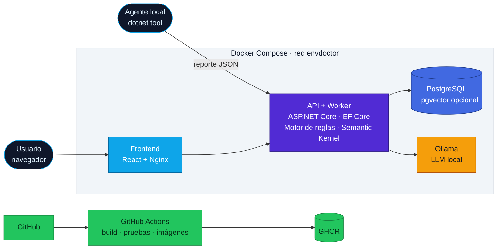
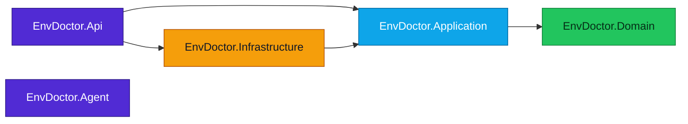
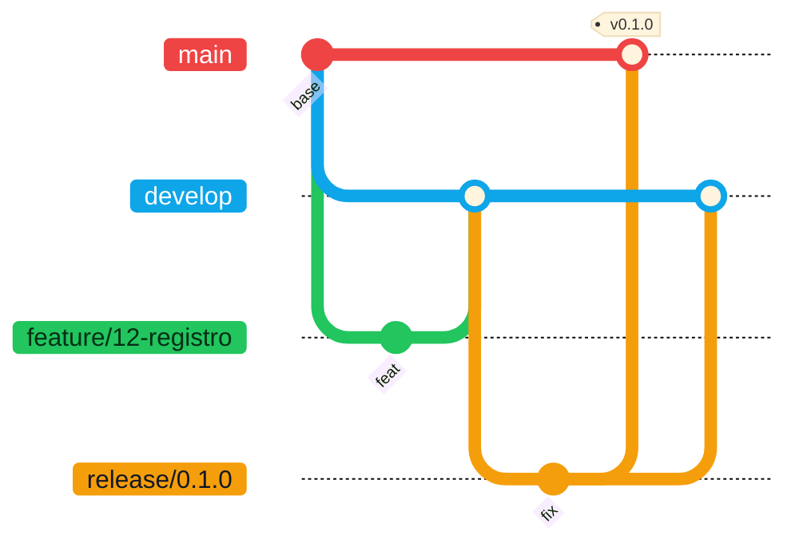

<div align="center">


# EnvDoctor

**Diagnostica por qué un proyecto no compila, no inicia o se comporta distinto entre computadoras,<br>
con reglas verificables y un asistente de IA que siempre cita la evidencia.**

[](https://github.com/luisbravobello/envDoctor/actions/workflows/ci.yml)


<br>

<a href="#stack-tecnológico">
  
</a>

<br><br>

[Características](#características) ·
[Arquitectura](#arquitectura) ·
[Inicio rápido](#inicio-rápido) ·
[Documentación](#documentación) ·
[Contribuir](CONTRIBUTING.md)

</div>

---

## Estado del proyecto

<div align="center">


| Indicador | Progreso |
|:--|:--|
| **Fase 0 · Fundación** |  |
| **Desarrollo total (fases 0 a 5)** |  |
| **Camino a producción (v1.0.0)** |  |

</div>

| Fase 0: entregable | Estado |
|:--|:--:|
| Repositorio con ramas `main` y `develop` |  |
| Esqueleto de backend (.NET) y frontend (React) |  |
| Docker Compose básico |  |
| CI mínimo en GitHub Actions |  |
| Protección de ramas |  |
| PRD |  |
| Backlog inicial en GitHub Issues |  |
| ADR-001 a ADR-005 |  |

> [!NOTE]
> El repositorio contiene la estructura base, sin lógica de negocio. Proyecto integral de **Software Configuration Management I**, opción 1 (Full Stack + IA + DevOps).

## Tabla de contenidos

- [Estado del proyecto](#estado-del-proyecto)
- [Qué es EnvDoctor](#qué-es-envdoctor)
- [Características](#características)
- [Stack tecnológico](#stack-tecnológico)
- [Arquitectura](#arquitectura)
- [Estructura del repositorio](#estructura-del-repositorio)
- [Inicio rápido](#inicio-rápido)
- [Flujo de trabajo](#flujo-de-trabajo)
- [Plan por fases](#plan-por-fases)
- [Documentación](#documentación)
- [Equipo](#equipo)

## Qué es EnvDoctor

En el desarrollo de software es común que una aplicación funcione en una computadora y falle en otra: versiones de SDK distintas, paquetes, variables de entorno, contenedores o puertos ocupados. EnvDoctor convierte esa información dispersa en un **informe de salud priorizado y trazable**.

Su diferencial es combinar **reglas deterministas**, que verifican hechos concretos, con **IA**, que ayuda a interpretarlos. La herramienta no inventa errores ni ejecuta reparaciones sin autorización del usuario.

## Características

| Módulo | Qué hace |
|:--|:--|
|  | Registrar un proyecto, subir el reporte del agente o un paquete del proyecto y seguir el progreso del análisis |
| -512BD4?style=flat-square&logo=dotnet&logoColor=white) | `dotnet tool` de solo lectura que detecta SDK, runtimes, Docker y puertos, y envía un reporte JSON con consentimiento |
|  | Lectura de `.sln`, `.csproj`, `TargetFramework`, paquetes NuGet y `global.json` |
|  | Reglas versionadas de SDK, dependencias, archivos, variables, Docker Compose y puertos |
|  | Hallazgos por severidad con evidencia, impacto y recomendación; filtros y marca de "no aplica" |
|  | Chat sobre el diagnóstico que explica causas probables y cita el hallazgo que lo respalda |
|  | Análisis anteriores y comparación de hallazgos entre dos ejecuciones |

## Stack tecnológico

| Capa | Tecnología |
|:--|:--|
| **Frontend** |     |
| **Backend** |     |
| **IA** |   |
| **Datos** |  -336791?style=for-the-badge&logo=postgresql&logoColor=white) |
| **Pruebas** |     |
| **Calidad** |    |
| **DevOps** |     |

## Arquitectura

Cuatro servicios contenerizados más el agente que corre en la máquina del desarrollador. Solo la API habla con PostgreSQL y con Ollama.



El backend sigue **Clean Architecture**: las dependencias apuntan hacia el dominio.



## Estructura del repositorio

```text
envDoctor/
├── src/
│   ├── EnvDoctor.Domain/           # Entidades y reglas del dominio, sin dependencias
│   ├── EnvDoctor.Application/      # Casos de uso e interfaces
│   ├── EnvDoctor.Infrastructure/   # EF Core, PostgreSQL, Semantic Kernel, analizadores
│   ├── EnvDoctor.Api/              # ASP.NET Core Web API + worker
│   └── EnvDoctor.Agent/            # Agente local (dotnet tool)
├── tests/
│   ├── EnvDoctor.UnitTests/
│   └── EnvDoctor.IntegrationTests/
├── frontend/                       # React + Vite, servido con Nginx en Docker
├── prompts/                        # Plantillas de prompts versionadas
├── samples/                        # Proyectos de ejemplo con errores conocidos
├── docs/                           # PRD, ADR, RFC, especificación y planes
├── .github/                        # Workflows y plantillas de PR e issues
├── docker-compose.yml
└── EnvDoctor.sln
```

## Inicio rápido

### Requisitos

| Herramienta | Versión |
|:--|:--|
|  | 8.0 (ver `global.json`) |
|  | 22 |
|  | Docker Desktop o Engine con Compose |

### Opción 1: todo con Docker

```bash
git clone https://github.com/luisbravobello/envDoctor.git
cd envDoctor
cp .env.example .env
docker compose up --build
```

| Servicio | URL |
|:--|:--|
|  | http://localhost:3000 |
|  | http://localhost:8080/health |
|  | `localhost:5432` |
|  | http://localhost:11434 |

### Opción 2: desarrollo local

```bash
# Backend
dotnet build EnvDoctor.sln
dotnet test EnvDoctor.sln
dotnet run --project src/EnvDoctor.Api

# Frontend (en otra terminal)
cd frontend
npm install
npm run dev
```

> [!TIP]
> Antes de abrir un PR ejecuta `dotnet format EnvDoctor.sln` y, en `frontend/`, `npm run lint && npm run format:check`.

## Flujo de trabajo

Git Flow simplificado. Todo cambio entra por Pull Request y pasa el CI.



| Rama | Propósito | Regla |
|:--|:--|:--|
|  | Producción; cada merge genera una versión | Solo PR desde `release/*`, CI verde, 1 aprobación |
|  | Integración del sprint | Solo PR desde `feature/*`, CI verde, 1 aprobación |
|  | Una historia de usuario | Nace de `develop` |
|  | Estabilizar la entrega | Se fusiona en `main` y `develop` |

**Convenciones:** [Conventional Commits](https://www.conventionalcommits.org/es/) (`feat:`, `fix:`, `docs:`), versiones [SemVer](https://semver.org/lang/es/) con tags `vX.Y.Z`. Detalles en [CONTRIBUTING.md](CONTRIBUTING.md).

## Plan por fases

| Fase | Meta | Estado |
|:--:|:--|:--:|
| 0 | Fundación: repo, ramas, esqueleto, Compose y CI mínimo |  |
| 1 | Escaneo básico de proyectos .NET |  |
| 2 | Diagnóstico: agente local y motor de reglas |  |
| 3 | Interfaz, historial e imágenes en GHCR |  |
| 4 | Asistente IA con Semantic Kernel y Ollama |  |
| 5 | Calidad, CD completo y release `v1.0.0` |  |

## Documentación

Toda la documentación vive en [`/docs`](docs/README.md), versionada junto al código.

| Producto | Técnica | Procesos |
|:--|:--|:--|
| [PRD](docs/01-prd.md) | [Especificación técnica](docs/05-especificacion-tecnica.md) | [Plan de pruebas](docs/08-plan-pruebas.md) |
| [Historias de usuario](docs/02-historias.md) | [Diseño de base de datos](docs/06-base-de-datos.md) | [Plan de implementación](docs/09-plan-implementacion.md) |
| [Reglas de negocio](docs/03-reglas-negocio.md) | [Catálogo de reglas](docs/04-catalogo-reglas.md) | [ADR](docs/adr/README.md) |
| [Guía UI/UX](docs/07-guia-ui-ux.md) | | [RFC](docs/rfc/0000-plantilla.md) |

## Equipo

| Integrante | Rol | Responsabilidades |
|:--|:--|:--|
| **Luis Bravo** |  | API, dominio, motor de reglas, agente local, base de datos |
| **Jeifferson** |  | Interfaz React, informe, historial y pantalla del asistente |
| **Ronald** |  | Semantic Kernel, Ollama, Docker, GitHub Actions, pruebas · Scrum Master |

---

<div align="center">


</div>
